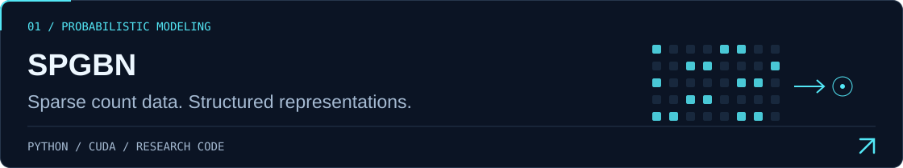
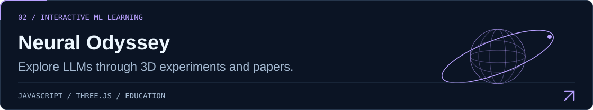
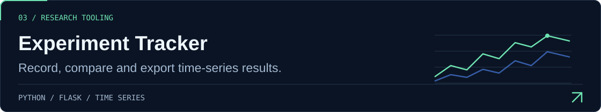
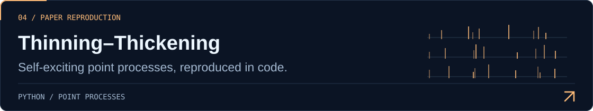

<picture>
  <source media="(prefers-reduced-motion: reduce) and (max-width: 767px)" srcset="assets/hero-mobile-static.svg">
  <source media="(prefers-reduced-motion: reduce)" srcset="assets/hero-desktop-static.svg">
  <source media="(max-width: 767px)" srcset="assets/hero-mobile.svg">
  
</picture>

 

  <strong>PhD student · Harbin Institute of Technology</strong> 
  Exploring machine learning, one paper and one experiment at a time.

  
  
  

## 01 / Selected work

<a href="https://github.com/HuangRuiiii/SPGBN">
  <picture>
    <source media="(max-width: 767px)" srcset="assets/spgbn-mobile.svg">
    
  </picture>
</a>

<a href="https://github.com/HuangRuiiii/neural-odyssey">
  <picture>
    <source media="(max-width: 767px)" srcset="assets/neural-odyssey-mobile.svg">
    
  </picture>
</a>

<a href="https://github.com/HuangRuiiii/experiment-tracker">
  <picture>
    <source media="(max-width: 767px)" srcset="assets/experiment-tracker-mobile.svg">
    
  </picture>
</a>

<a href="https://github.com/HuangRuiiii/Thinning-Thickening">
  <picture>
    <source media="(max-width: 767px)" srcset="assets/thinning-thickening-mobile.svg">
    
  </picture>
</a>

Project index

- **[SPGBN](https://github.com/HuangRuiiii/SPGBN)** — Sparse Poisson Gamma Belief Networks for high-dimensional sparse count data.
- **[Neural Odyssey · 神经漫游](https://github.com/HuangRuiiii/neural-odyssey)** — interactive LLM learning, 3D experiments and paper guides in Chinese.
- **[Experiment Tracker](https://github.com/HuangRuiiii/experiment-tracker)** — experiment logging, comparison and export for time-series research.
- **[Thinning–Thickening](https://github.com/HuangRuiiii/Thinning-Thickening)** — reproduction of *Estimation of self-exciting point processes from time-censored data*.

## 02 / Learning notes

From reading a paper to understanding the idea behind it.

**[EM → VAE](https://huangruiiii.github.io/2024/12/EM_to_VAE/)** &nbsp; / &nbsp; Expectation–maximization &amp; variational autoencoders  
**[Diffusion Model](https://huangruiiii.github.io/2025/03/Diffusion_Model/)** &nbsp; / &nbsp; Notes on diffusion models

<samp>read → implement → experiment → repeat</samp>

