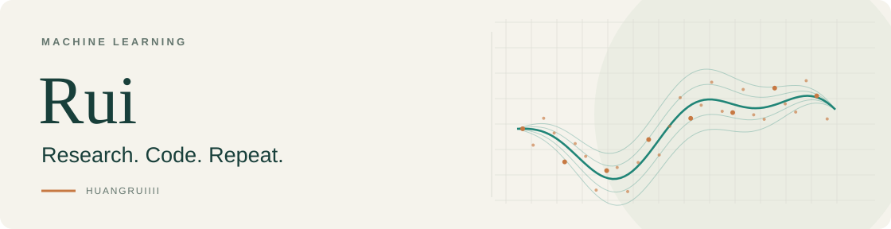

<picture>
  <source media="(prefers-color-scheme: dark)" srcset="assets/header-dark.svg">
  <source media="(prefers-color-scheme: light)" srcset="assets/header-light.svg">
  
</picture>

 

  <strong>PhD student · Harbin Institute of Technology</strong> 
  Exploring machine learning, one paper and one experiment at a time.

  <a href="https://huangruiiii.github.io/">Notes &amp; Blog</a> &nbsp;·&nbsp;
  <a href="mailto:24B951056@stu.hit.edu.cn">Email</a> &nbsp;·&nbsp;
  <a href="https://github.com/HuangRuiiii?tab=repositories">All repositories</a>

## Research & projects

<table>
  <tr>
    <td width="100%" valign="top">
      01 / PROBABILISTIC MODELING
      <h3><a href="https://github.com/HuangRuiiii/SPGBN">SPGBN ↗</a></h3>
      
Sparse Poisson Gamma Belief Networks for feature extraction from high-dimensional sparse count data.

      
<code>Python</code> <code>CUDA</code> <code>Research code</code>

    </td>
  </tr>
  <tr>
    <td width="100%" valign="top">
      02 / INTERACTIVE LEARNING
      <h3><a href="https://github.com/HuangRuiiii/neural-odyssey">Neural Odyssey · 神经漫游 ↗</a></h3>
      
A Chinese-language learning space for LLMs, with interactive 3D experiments and guided paper reading.

      
<code>JavaScript</code> <code>Three.js</code> <code>ML education</code>

    </td>
  </tr>
  <tr>
    <td width="100%" valign="top">
      03 / RESEARCH TOOLING
      <h3><a href="https://github.com/HuangRuiiii/experiment-tracker">Experiment Tracker ↗</a></h3>
      
A tool for recording, comparing and exporting time-series experiment results, with a web UI and Python client.

      
<code>Python</code> <code>Flask</code> <code>Time series</code>

    </td>
  </tr>
  <tr>
    <td width="100%" valign="top">
      04 / PAPER REPRODUCTION
      <h3><a href="https://github.com/HuangRuiiii/Thinning-Thickening">Thinning–Thickening ↗</a></h3>
      
A reproduction of <em>Estimation of self-exciting point processes from time-censored data</em>.

      
<code>Python</code> <code>Point processes</code>

    </td>
  </tr>
</table>

## Learning notes

I write to work through the ideas behind the code.

- **[EM to VAE](https://huangruiiii.github.io/2024/12/EM_to_VAE/)** — notes on expectation–maximization and variational autoencoders.
- **[Diffusion Model](https://huangruiiii.github.io/2025/03/Diffusion_Model/)** — notes on diffusion models.

 

Read papers. Write code. Repeat and repeat again.

